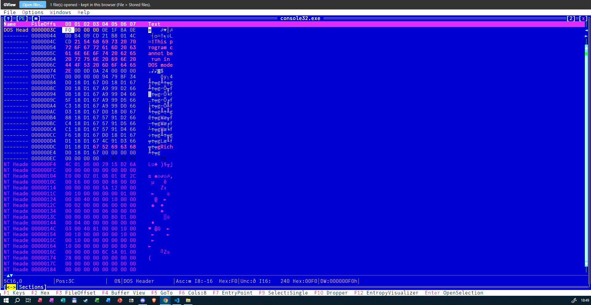
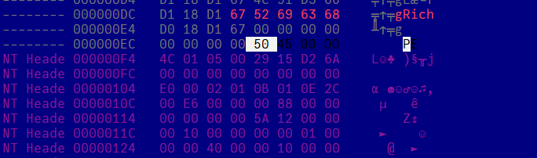
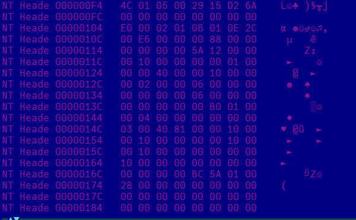
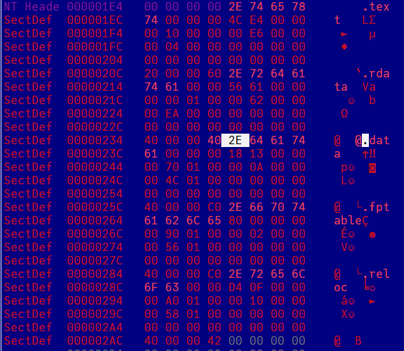
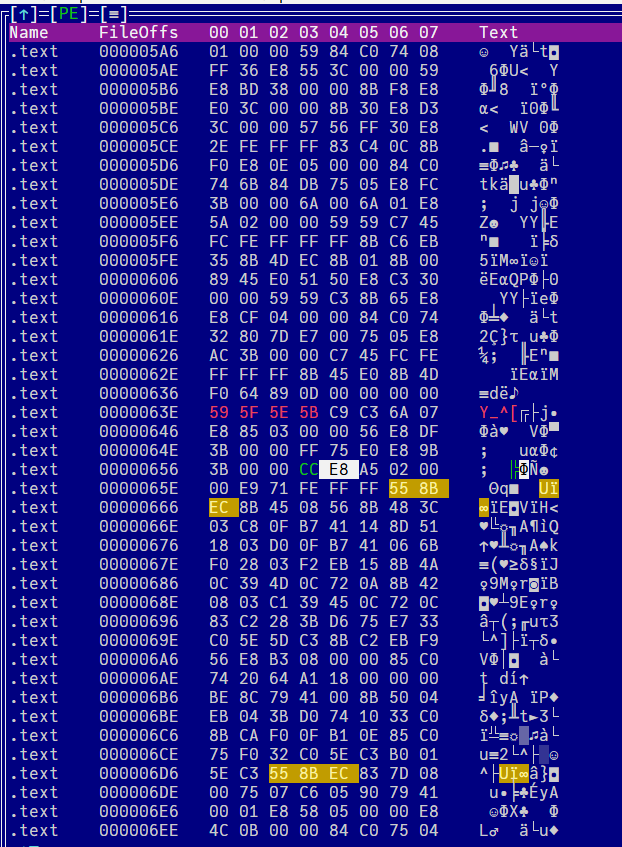

# Exercițiul 1 — Analiza manuală a unui fișier PE: `console32.exe`

**Fișier analizat:** `valid/console32.exe`  
**Instrument folosit:** [GView](https://github.com/gdt050579/GView/releases) (vizualizare hexadecimală)  
**Scop:** identificarea manuală a antetelor PE, a primei secțiuni și a punctului de intrare, înainte de implementarea parserului.

Valorile de mai jos au fost verificate în capturile din GView, cu excepția identificării exacte a compilatorului, care rămâne o ipoteză.

## 1. Ce octeți se află la offsetul `0x3C`? Care este valoarea `e_lfanew`?

**Răspuns:** la offsetul `0x3C` se găsesc octeții `F0 00 00 00`, iar **`e_lfanew = 0x000000F0`**.

| Element          | Valoare       |
| ---------------- | ------------- |
| Offset verificat | `0x3C`        |
| Octeți           | `F0 00 00 00` |
| `e_lfanew`       | `0xF0`        |

Formatul PE folosește ordinea **little-endian**, deci octetul cel mai puțin semnificativ este stocat primul. `e_lfanew` este un câmp al antetului DOS care indică offsetul din fișier unde începe semnătura PE.



## 2. Ce semnătură PE și ce valori COFF se găsesc la `e_lfanew`?

**Răspuns:** la `0xF0` se află semnătura **`50 45 00 00`** (`PE\0\0`). Antetul COFF începe la `0xF4`, iar primii săi opt octeți sunt **`4C 01 05 00 29 15 D2 6A`**.

```text
Offset 0xF0: 50 45 00 00             -> PE\0\0
Offset 0xF4: 4C 01 05 00 29 15 D2 6A -> începutul COFF Header
```

| Câmp COFF          | Octeți        | Valoare interpretată                               |
| ------------------ | ------------- | -------------------------------------------------- |
| `Machine`          | `4C 01`       | `0x014C` — x86 (32 de biți)                        |
| `NumberOfSections` | `05 00`       | `5` secțiuni                                       |
| `TimeDateStamp`    | `29 15 D2 6A` | `0x6AD21529` — **16 octombrie 2026, 12:14:33 UTC** |

Timestampul este interpretat ca timp Unix (secunde de la 1 ianuarie 1970, UTC). El este o valoare înscrisă în antet și **nu dovedește singur data reală a compilării**, deoarece poate fi modificat.



## 3. Unde începe Optional Header? Este PE32 sau PE32+? Care sunt `AddressOfEntryPoint` și `ImageBase`?

**Răspuns:** Optional Header începe la **`0x108`**. Fișierul este **PE32**, cu `AddressOfEntryPoint = 0x125A` și `ImageBase = 0x400000`.

Semnătura PE are 4 octeți, iar COFF Header are 20 de octeți:

```text
OptionalHeaderOffset = e_lfanew + 4 + 20
                     = 0xF0 + 0x04 + 0x14
                     = 0x108
```

| Câmp                  | Offset în fișier | Octeți        | Valoare         |
| --------------------- | ---------------- | ------------- | --------------- |
| `Magic`               | `0x108`          | `0B 01`       | `0x010B` — PE32 |
| `AddressOfEntryPoint` | `0x118`          | `5A 12 00 00` | `0x125A` (RVA)  |
| `ImageBase`           | `0x124`          | `00 00 40 00` | `0x00400000`    |

Valoarea `Magic = 0x010B` indică **PE32**, nu PE32+ (`0x020B`). `AddressOfEntryPoint` este un **RVA** (_Relative Virtual Address_), iar `ImageBase` este adresa preferată de încărcare în memorie.



## 4. Unde începe tabelul secțiunilor? Cum se numește prima secțiune și care sunt `VirtualAddress` și `PointerToRawData`?

**Răspuns:** tabelul secțiunilor începe la **`0x1E8`**. Prima secțiune este **`.text`**, cu `VirtualAddress = 0x1000` și `PointerToRawData = 0x400`.

Dimensiunea Optional Header este `0xE0`, deci:

```text
SectionTableOffset = OptionalHeaderOffset + SizeOfOptionalHeader
                   = 0x108 + 0xE0
                   = 0x1E8
```

| Câmp                    | Offset în fișier | Valoare                             |
| ----------------------- | ---------------- | ----------------------------------- |
| Începutul Section Table | `0x1E8`          | —                                   |
| `Name`                  | `0x1E8`          | `.text` (`2E 74 65 78 74 00 00 00`) |
| `VirtualAddress`        | `0x1F4`          | `0x1000` (`00 10 00 00`)            |
| `PointerToRawData`      | `0x1FC`          | `0x400` (`00 04 00 00`)             |

Secțiunea `.text` conține în mod obișnuit cod executabil. `VirtualAddress` indică RVA-ul începutului secțiunii în memorie; `PointerToRawData` indică offsetul începutului datelor acelei secțiuni pe disc.



## 5. La ce offset din fișier se află prima instrucțiune? La ce adresă virtuală (VA) o arată un debugger?

**Răspuns:** prima instrucțiune de la Entry Point se află la **offsetul `0x65A`** din fișier. La baza de încărcare preferată, adresa sa virtuală este **`0x40125A`**.

Valori cunoscute:

- Entry Point RVA = `0x125A`
- `.text` VirtualAddress = `0x1000`
- `.text` PointerToRawData = `0x400`
- ImageBase = `0x400000`

Calculul offsetului pe disc:

```text
FileOffset = RVA - VirtualAddress + PointerToRawData
           = 0x125A - 0x1000 + 0x400
           = 0x65A
```

Calculul VA:

```text
VA = ImageBase + RVA
   = 0x400000 + 0x125A
   = 0x40125A
```

**Notă:** `0x40125A` este adresa virtuală _preferată_. Dacă Windows încarcă imaginea la altă bază (de exemplu, din cauza ASLR), adresa efectivă afișată de debugger se calculează folosind noua bază.

## 6. Ce instrucțiuni se află la Entry Point? Ce compilator ar putea fi folosit?

**Răspuns:** la offsetul `0x65A`, primii zece octeți sunt:

```text
E8 A5 02 00 00 E9 71 FE FF FF
```

| Octeți           | Instrucțiune x86 | Explicație                                       |
| ---------------- | ---------------- | ------------------------------------------------ |
| `E8 A5 02 00 00` | `CALL` relativ   | Apelează o funcție folosind o deplasare relativă |
| `E9 71 FE FF FF` | `JMP` relativ    | Efectuează un salt relativ                       |

În codul din apropiere apare și secvența `55 8B EC`, un prolog clasic de funcție x86, asociat frecvent cu stilul de cod generat de **Microsoft Visual C++ (MSVC)**.

**Ipoteză:** fișierul ar putea fi construit cu MSVC. **Nu este o identificare sigură**, deoarece asemenea secvențe pot fi generate și de alte compilatoare sau pot apărea în cod modificat. Pentru confirmare se poate folosi **Detect It Easy** sau analiza **Rich Header** (vizibil și în zona antetelor în GView).



## Concluzie

Am identificat manual în GView antetul DOS, semnătura PE, câmpurile principale din COFF Header și Optional Header, precum și prima secțiune, `.text`. Am calculat poziția punctului de intrare atât pe disc (`0x65A`), cât și la adresa virtuală preferată (`0x40125A`), apoi am verificat instrucțiunile `CALL` și `JMP` de la Entry Point. Aceste operații stau la baza unui parser PE și a analizei statice a executabilelor Windows.

## Capturi suplimentare GView

- [Vizualizarea Disassembly inițială](../screenshots/01-vizualizare-disassembly.png) — confirmă deschiderea executabilului în GView.
- [Vizualizarea Buffer inițială](../screenshots/02-buffer-vizualizare-initiala.png) — arată structura fișierului înainte de navigarea la câmpurile analizate.
